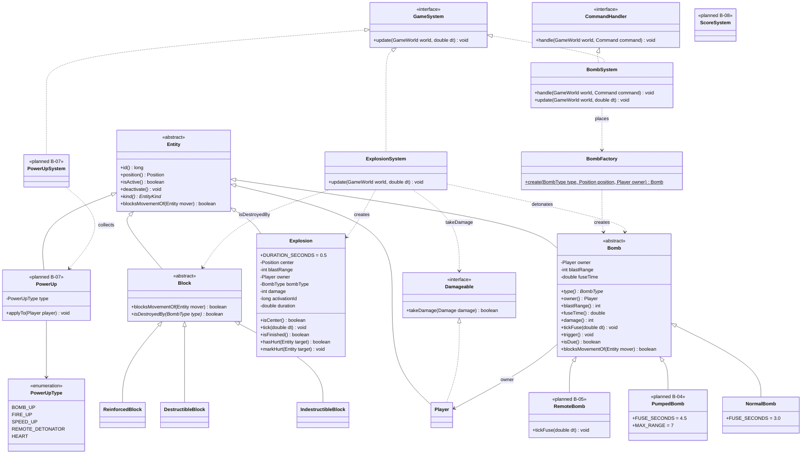

# Class Diagram — Marshall's packages

Input for `S-05`. Covers `model/bomb`, `model/explosion`, `model/block`, `model/powerup`, and `engine/bomb`. Classes marked `<<planned>>` do not exist yet; their task is in the note. Types owned by other members (`Entity`, `Player`, `GameWorld`, `GameSystem`, `CommandHandler`, `Damageable`, `EventBus`) are shown only where Marshall's classes use them.

GitHub renders the diagram below. To export an image, paste it into <https://mermaid.live>.

## Patterns and principles shown

| Item | Where |
| --- | --- |
| Inheritance | `Bomb` with three bomb types, `Block` with three block types. |
| Abstract class | `Bomb`, `Block`. |
| Polymorphism | `Bomb.type()`, `Block.isDestroyedBy()`, `Damageable.takeDamage()`. |
| Factory Method | `BombFactory` creates a bomb from `BombType`. |
| Observer | `ScoreSystem` subscribes to `EnemyDefeated` and `GameEnded` on the `EventBus`. |
| Open/Closed | A new bomb or block type is a new subclass; `BombSystem` and `ExplosionSystem` do not change. |
